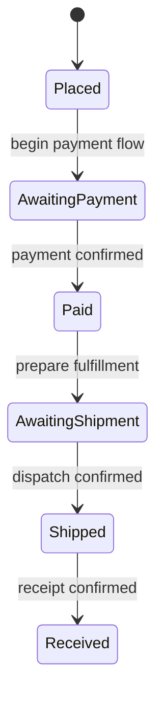

# Chapter 7: Design Conventions

**Source:** Printed pp. 48-50, rules 1-19. **Levels:** M = mandatory, R = recommended, F = reference.

## Core Idea

Identify the system's hard parts, express them precisely, and preserve the decisions needed for later change. Documents and diagrams make dependencies, states, boundaries, and failure behavior reviewable beyond the local code.

## Frameworks Introduced

### Required Diagram Selection — M, Rules 2-6

Use the smallest diagram that expresses the complexity actually present. Preserve the conjunctions in these thresholds; the conditions are not interchangeable.

| Condition | Required representation | Express |
|---|---|---|
| More than one actor type **and** more than five use cases | Use-case diagram | Actors and supported interactions |
| A business object has more than three states | State diagram | States, allowed transitions, triggering conditions |
| A feature's call chain involves more than three objects | Sequence diagram | Calls and each link's input/output |
| More than five model classes **and** complex dependencies | Class diagram | Class relationships |
| More than two collaborating objects **and** complex workflow | Activity diagram | Flow, collaboration/swimlanes, concurrency where applicable |

These are the source's mandatory edition thresholds, not universal UML rules. For state models, identify direct transitions explicitly; “order placed” cannot jump directly to “received” merely because both states exist.

### Storage and Data-Structure Review — M, Rule 1

Before changing storage or foundational data structures:

1. Review storage medium, schema, names/types, field/table relationships, indexes, access performance, capacity, and anticipated growth.
2. Obtain review agreement and capture the decision in a document.
3. Include schema changes such as an added field; do not assume a small diff removes design impact.
4. Double-check what was actually executed in production against the reviewed design.

Why it works: persisted data and historical migrations make foundational errors expensive to reverse. Local compiling code is insufficient evidence of a sound storage decision.

### Design for Change — R, Rules 9-13; F Rule 16

- **Single responsibility:** State why the class exists; move unrelated reasons for change into separate responsibilities.
- **Composition before inheritance:** Extend behavior through aggregation/composition first. If inheritance is necessary, preserve **Liskov substitution**: a subtype remains usable wherever the parent contract is required.
- **Dependency inversion:** Depend on abstractions/interfaces that express the needed capability, allowing implementations to change without coupling business logic to infrastructure details.
- **Open/closed principle:** Isolate understood variation points so new behavior can extend stable code rather than repeatedly modifying it.
- **DRY — Don't Repeat Yourself:** Extract genuinely common behavior/configuration so a business rule has one maintained definition. Repeated parameter checking is the source's example.

How: locate the real change axis, choose a responsibility/contract, and share only behavior with the same meaning. Why it works: coordinated edits to many copies or coupled subclasses are error-prone. This is not a mandate to build abstraction for every hypothetical future requirement.

## Architecture and Requirements Rules

**R, rules 7-8:** State the system boundary, module relationships and macro inputs/outputs, evolution principles, and nonfunctional requirements such as security, availability, and extensibility. Evaluate abnormal flows and business boundaries together with the happy path. A working principal flow does not establish what happens after a timeout or partial completion.

**R, rule 14:** Agile delivery retains necessary design and durable documentation at critical points. The source rejects treating agility as only stories, coding, and release; it calls for discarding unnecessary work while keeping important design decisions.

**F, rules 15-18:** Design documents clarify requirements, logic, and maintenance. Classify/archive the results. Extensibility means finding and isolating variation points. Design requires both identifying difficulty and expressing it clearly. Code is part of documentation, not the whole account of call depth, module dependencies, business scenarios, and nonfunctional requirements.

## Accessibility — F, Rule 19

All interactive controls should accept Tab focus in natural task order. Login/request-validation captchas need an alternative to visual-only challenges. Custom controls need explicit interaction semantics, such as appropriate roles. The source login example follows username, password, verification, submit, with audio verification available. Preserve these as reference guidance while following the project's actual accessibility standard.

## Key Concepts

- **System boundary:** What the system owns and what lies outside its responsibilities.
- **Nonfunctional requirement:** Quality requirement such as availability, security, or extensibility.
- **State transition:** Allowed change of state with a specified trigger.
- **Sequence diagram:** Ordered interaction among collaborating objects.
- **Variation point:** Deliberate boundary around behavior expected to change.
- **Liskov substitution:** Subtypes satisfy the usable contract of their parent type.
- **Dependency inversion:** Implementation dependencies follow stable capability abstractions.
- **DRY:** One maintained definition for shared knowledge/behavior.
- **Accessible interaction:** Input and feedback remain usable through supported alternative modalities.

## Mental Models

- Select an artifact by the question it must answer, not by diagram fashion.
- Persisted structures amplify migration cost; review them before committing data.
- Isolate a real variation point; hypothetical flexibility is not automatically valuable.
- A system's exception path is a design path, not a late catch block.

## Reference Table

| Review question | Evidence to seek |
|---|---|
| Is a storage change agreed? | Reviewed schema/data-structure decision and execution double-check |
| Are states unambiguous? | Transition map, triggers, and prohibited direct edges |
| Can a call chain be followed? | Sequence with inputs/outputs and boundary failures |
| Are responsibilities coupled? | Clear class purpose and capability contracts |
| Is the same rule copied? | One definition shared only where semantics match |
| Are quality requirements testable? | Explicit availability/security/growth objectives and relevant checks |
| Can keyboard users complete the flow? | Natural focus order and nonvisual verification option |

## Worked Example

Source scenario: bank debit succeeds and the user receives confirmation, but a network failure prevents crediting the receiving payment system. The order still shows unpaid. This demonstrates why design must include partial completion.

Reconstructed design review:

1. State which system owns debit, incoming credit, and order status.
2. Record the successful intermediate state without pretending the whole payment succeeded or failed atomically.
3. Express calls and input/output contracts in a sequence diagram when the source's object-count threshold applies.
4. Add the failure transition and recovery/reconciliation responsibilities. These recovery details are an application design decision, not an algorithm supplied by the manual.
5. Define what users see while the outcome is unresolved and how operators trace it.
6. Add design-derived tests for the partial-success path, alongside the normal success path.

Compact diagram adaptation of the source's order-state example:

The diagram illustrates allowed normal transitions, not the complete order model. Add failure/cancellation states from actual requirements; do not infer a direct Placed-to-Received edge.

## Anti-patterns

- A foundational schema is changed without reviewed storage implications.
- Diagrams name states but omit triggering/forbidden transitions.
- A payment design models only total success despite multiple systems.
- Inheritance violates parent contracts or couples unrelated change.
- Copied validation rules diverge between methods.
- “Agile” is used to discard needed decisions and maintenance context.
- Clear local code is assumed to document system-wide requirements.

## Key Takeaways

1. Review and document durable structures before changing them.
2. Apply exact diagram conditions, including their conjunctions.
3. Model boundary/failure behavior alongside the main flow.
4. Isolate real variation and maintain common rules once.
5. Preserve decision rationale for future maintainers.

## Connects To

- [Ch01](ch01-programming.md): Guard clauses, naming, and compatible contracts.
- [Ch03](ch03-unit-testing.md): BCDE Design/Error cases from documented requirements.
- [Ch04](ch04-security.md): Security requirements at each boundary.
- [Ch05](ch05-mysql.md): Schema, integrity, and migration implications.
- [Ch06](ch06-project-structure.md): Layers, dependency direction, and shared contracts.
